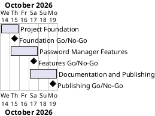

# Password Manager Project Plan

## Metadata
| Key | Value |
| --- | --- |
| ID | PP-001 |
| CrossReference | [BC-001], [SA-001], [MIL-001], [MIL-002], [MIL-003] |
| Language | en |
| Domain | it |

## Version History
| Date | Status | Author | Reviewer | Change | Commit |
| --- | --- | --- | --- | --- | --- |
| 2026-10-14 | Accepted | Jens Tirsvad Nielsen | S01 | Initial version | pending |

---

# Password Manager Project Plan

## Purpose

Schedule the three gateways that take the password manager from an empty
repository to a published, tested and documented project. The Business Case
sets no deadline, so the plan keeps the phases short and sequential.

## Planning Assumptions

- Work starts 2026-10-14 and the plan ends 2026-10-19.
- Each phase is one branch and one pull request, and its tasks are Issues.
- S01 reviews every artifact; in autonomous mode the AI acts as stand-in for S01
  and the review records say so ([SA-001]).
- Product Owner language is English (domain `it`); the wiki exists in English,
  Danish and Bahasa Malaysia as the Business Case requires ([BC-001]).
- The application is a user interface, so the presentation pattern is MVVM.
  The wireframe is the course's layout: logo on top, then Website with a
  Search button, Email/Username, Password with a Generate button, and a wide
  Add button.

## Gateway Schedule

| Gateway | Document | Window | Decision date | Owner | Stories | Main deliverable | Milestone |
| --- | --- | --- | --- | --- | --- | --- | --- |
| Project Foundation | [MIL-001] | 2026-10-14 to 2026-10-15 | 2026-10-15 | S01 | none | pyproject.toml, .gitignore, constants.py, Doxyfile, README, repository description and topics | |
| Password Manager Features | [MIL-002] | 2026-10-15 to 2026-10-17 | 2026-10-17 | S01 | none | JSON storage, exception handling, search, generator, window and tests | |
| Documentation and Publishing | [MIL-003] | 2026-10-17 to 2026-10-19 | 2026-10-19 | S01 | none | Screenshots, README with screenshots, wiki in en, da and ms | |



## Scope Coverage

| Business Case scope item | Gateway |
| --- | --- |
| Password generation, saving to JSON, searching by website | [MIL-002] |
| Exception handling for a missing, empty or invalid data file | [MIL-002] |
| A Tkinter window with the assignment's fields and buttons | [MIL-002] |
| `pyproject.toml`, pytest tests, `constants.py`, `.gitignore`, Doxyfile, Doxygen comments | [MIL-001] and [MIL-002] |
| README | [MIL-001], completed with screenshots in [MIL-003] |
| Wiki in English, Danish and Bahasa Malaysia, screenshots | [MIL-003] |
| Repository description and topics | [MIL-001] |
| Local `.venv` and pip upgrade instructions | [MIL-001] |

## Dependencies

```
MIL-001 -> MIL-002 -> MIL-003
```

A No-Go on a gateway holds every later gateway; the later dates move by the
rework time.

## Plan Risks

| Risk | Impact | Mitigation |
| --- | --- | --- |
| The git host token cannot edit repository metadata or merge | Description, topics or merge steps fail | Stop and report as autonomous mode requires; the user performs the step |
| Screenshots cannot be captured in the session | README and wiki lack images | Capture the window with a documented script; if impossible, stop and report |
| The wiki publish workflow has no runner | Wiki does not reach the host | The pages stay in `docs/wiki/`; report and let the user decide how to publish |

## Open Issues

- No use cases or user stories are modelled: the tasks are technical steps of
  the course assignment, so every task is a plain task.
- The Domain Dictionary (`DICT`) is created with the first milestone review so
  that the language checklist can be applied.

---

[BC-001]: ./business-case.md
[SA-001]: ./stakeholder-analysis.md
[MIL-001]: ./milestones/mil-001-project-foundation.md
[MIL-002]: ./milestones/mil-002-password-manager-features.md
[MIL-003]: ./milestones/mil-003-documentation-and-publishing.md
